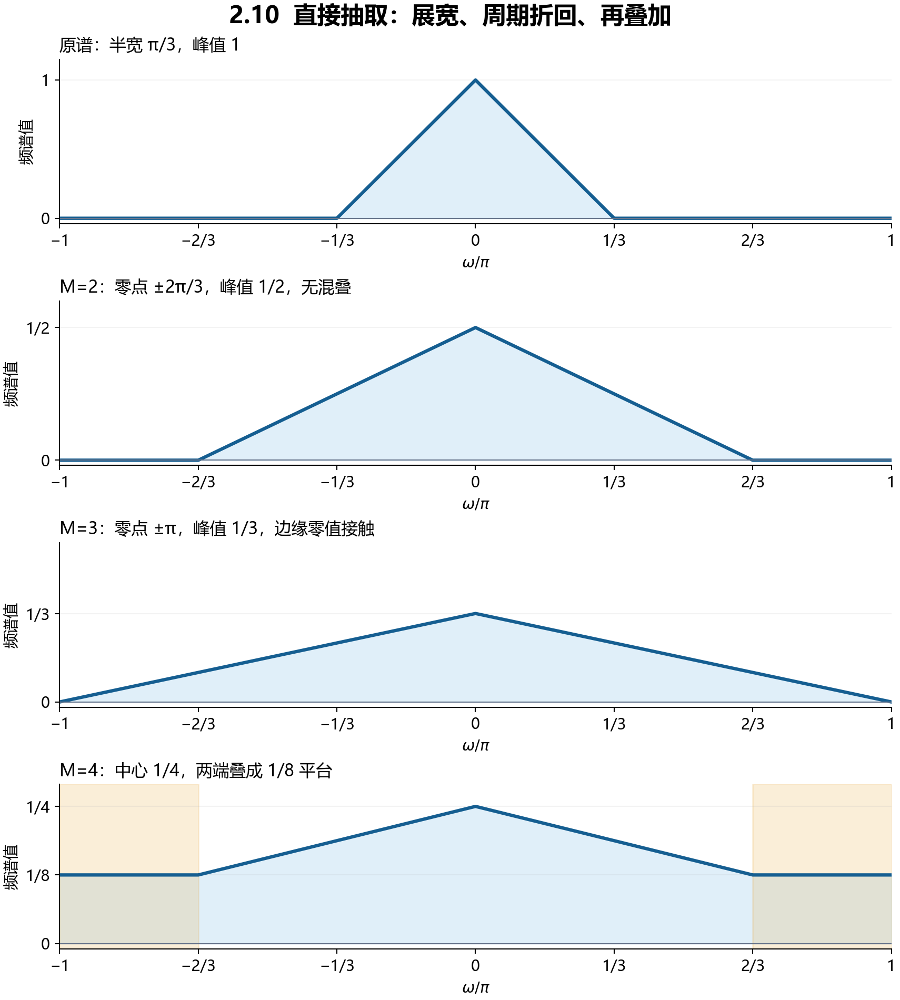
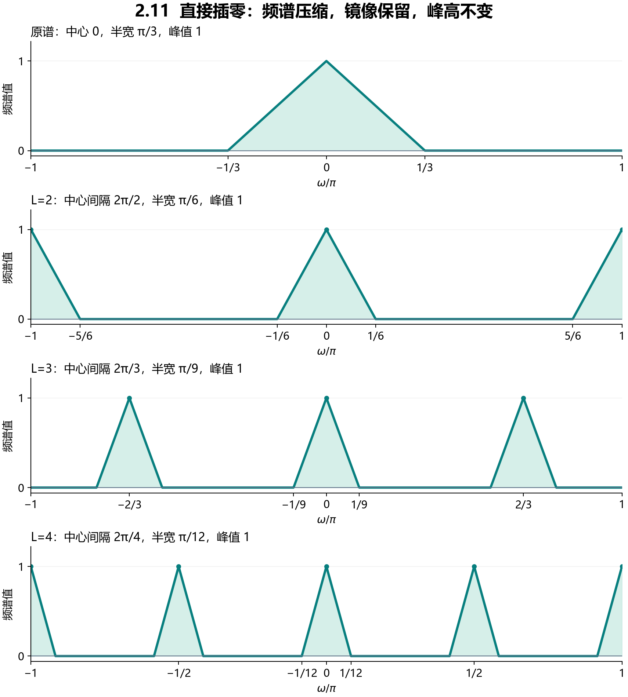

# 第二章 · 采样与重建

> 指定作业：**2.4、2.10、2.11**。
> 本章按作业 PDF 的章名编号。重点是模拟—数字频率换算、抽取的频谱混叠、插零的频谱镜像。

## 本章题型路线

| 题面给什么 | 先写什么 | 对应题号 |
|---|---|---|
| 模拟正弦、采样率和数字频响 | 先用 $\omega=\Omega T$ 找到应代入的频率 | 2.4 |
| 直接抽取 $x[Mn]$ | 展宽、除以 $M$，将越界副本折回后相加 | 2.10 |
| 直接插零，保留原样本 | 代入 $X(e^{jL\omega})$，列中心和半宽 | 2.11 |

## 【作业】2.4：A/D—数字系统—D/A 的输出

> **做题必备知识**　两端是模拟频率，中间是数字频率。先用 $\omega=\Omega T$ 进数字域，频响改幅度和相位，理想 D/A 再按同一个 $T$ 换回。

### 三种频率的单位与换算

| 符号 | 含义 | 单位 | 关系 |
|---|---|---|---|
| $f$ | 模拟频率 | Hz | $\Omega=2\pi f$ |
| $\Omega$ | 模拟角频率 | rad/s | $\omega=\Omega T$ |
| $\omega$ | 数字角频率 | rad/sample | $\omega=2\pi f/f_s$ |

采样周期 $T=1/f_s$。对 $x_a(t)=\sin(\Omega_0t)$ 采样：

$$
x[n]=x_a(nT)=\sin(\Omega_0Tn)=\sin(\omega_0n).
$$

数字频率以 $2\pi$ 为周期；画 DTFT 常取主值区间 $[-\pi,\pi]$，区间外还要按 $2\pi$ 重复。

### 1. 正弦通过 LTI 系统

若系统在 $\omega_0$ 的频率响应为

$$
H(e^{j\omega_0})=A e^{j\varphi},
$$

则实系数 LTI 系统对正弦的稳态响应为

$$
\sin(\omega_0n+\theta)
\longrightarrow A\sin(\omega_0n+\theta+\varphi).
$$

**频率保持，幅度乘 $A$，相位加 $\varphi$。** 若题目另外规定了有限时刻开机和初值，还要考虑瞬态；2.4 未给这些条件，按理想转换链路与正弦稳态解释。

### 题目

信号依次经过 A/D、数字系统 $H(e^{j\omega})$、D/A，其中

$$
H(e^{j\omega})=\frac1{1-0.3e^{-j\omega}},\qquad
f_s=2\ \mathrm{kHz},\qquad
x_a(t)=\sin(1000\pi t).
$$

求模拟输出 $y_a(t)$。按理想 A/D、同采样率的理想重建 D/A 求解。

### 第一步：识别输入频率

$$
\Omega_0=1000\pi\ \mathrm{rad/s},\qquad
f_0=\frac{\Omega_0}{2\pi}=500\ \mathrm{Hz}.
$$

采样频率 $2000>2\times500$，输入正弦不发生混叠。

### 第二步：转换为数字频率

$$
T=\frac1{2000}\ \mathrm{s},\qquad
\omega_0=\Omega_0T=\frac\pi2.
$$

故

$$
x[n]=\sin\left(\frac\pi2n\right).
$$

### 第三步：在该数字频率处计算 H

$$
e^{-j\pi/2}=-j,
$$

因此

$$
H(e^{j\pi/2})=\frac1{1+0.3j}
=\frac{1-0.3j}{1.09}.
$$

其幅值与相位是

$$
|H|=\frac1{\sqrt{1.09}}\approx0.957826,
\qquad \angle H=-\arctan(0.3)\approx-0.291457\ \mathrm{rad}.
$$

所以数字输出为

$$
y[n]=\frac1{\sqrt{1.09}}
\sin\left(\frac\pi2n-\arctan0.3\right).
$$

### 第四步：理想重建回模拟域

重建频率为

$$
\Omega_{\mathrm{out}}=\frac{\omega_0}{T}=1000\pi.
$$

最终

$$
\boxed{
y_a(t)=\frac1{\sqrt{1.09}}
\sin\left(1000\pi t-\arctan0.3\right).
}
$$

也可写为 $0.957826\sin(1000\pi t-0.291457)$。

### 同类大题怎么写

$$
\Omega_0\ \longrightarrow\ \omega_0=\Omega_0T
\ \longrightarrow\ H(e^{j\omega_0})
\ \longrightarrow\ y[n]
\ \longrightarrow\ y_a(t).
$$

多频输入就逐项走这条链，再利用线性叠加。若模拟输入超过 Nyquist 频率，先求采样后的等效数字频率，不能默认输出仍恢复原模拟频率。

**易错**：把 $1000\pi$ 当作 Hz；把 $f_s$ 的 2 kHz 当作 2 Hz；算成 $e^{-j\pi/2}=j$；只改幅值不改相位；把理想转换中间的谱尺度系数误留成最终额外的 $T$ 或 $1/T$。

## 【期末原题】第 1 题 · 125 Hz 正弦采样

> **做题必备知识**　先写出奈奎斯特速率，再把临界采样率代回正弦。非零周期序列的最小正整数周期，可从最简频率比的分母判断。

奈奎斯特速率是 250 Hz。若从 $t=0$ 按该速率采样，$x[n]=\sin(\pi n)=0$，样点不保留这个正弦。零序列本身是周期序列，任意正整数都是它的周期。若第（3）问在 $f_s>250$ Hz 下求非零序列最短的整数周期，令 $125/f_s=p/q\in(0,1/2)$ 为最简分数，最小可取 $q=3,p=1$，故 $f_s=375$ Hz、$x[n]=\sin(2\pi n/3)$。原参考解给的 500 Hz 是一个可行解，周期为 4。

## 【期末原题】第 4 题 · 采样后求周期

> **做题必备知识**　用 $\omega=2\pi f/f_s$ 换算，最高频率落在 $\pi$ 时再看初相位。多项相加时先取各项周期的最小公倍数。

频率为 1500 和 4000 Hz，奈奎斯特速率 8000 Hz。按题面取临界速率且从 $t=0$ 采样，得到 $\sin(3\pi n/8)+(-1)^n$。两个基波周期为 16、2，总和最小周期 16。临界点这里是零初相余弦，因此样本保留了该分量；一般相位的边界正弦需另作判断，要保证任意相位无歧义时用严格大于。

## 【作业】2.10：直接抽取后的频谱

> **做题必备知识**　抽取谱中的每一份三角谱横轴展宽 $M$ 倍、幅值乘 $1/M$。超出主值区间的部分需按 $2\pi$ 折回并逐点相加。

### 抽取与插零的公式并排记

抽取 $M$ 倍：

$$
y[n]=x[Mn],\qquad
Y(e^{j\omega})=\frac1M\sum_{r=0}^{M-1}
X\left(e^{j(\omega-2\pi r)/M}\right).
$$

插零 $L$ 倍：

$$
v[n]=\begin{cases}x[n/L],&n=Lm,\\0,&\text{其他},\end{cases}
\qquad V(e^{j\omega})=X(e^{jL\omega}).
$$

| 操作 | 单个谱形的横轴 | 幅度系数 | 最需警惕 |
|---|---|---|---|
| 抽取 M 倍 | 展宽 M 倍，移位副本叠加 | 每份乘 1/M | 超过主值区间的部分折回，可能相加 |
| 插零 L 倍 | 压缩为 1/L，出现 L 份镜像 | 无额外 1/L | 不要漏画镜像；直接插零不等于已低通插值 |

这两题都明确说“不滤波”，不能自行删去混叠或镜像。

### 题目与原谱

原序列的频谱在一个主值区间内为三角形：

$$
X(e^{j\omega})=\begin{cases}
1-\dfrac{3|\omega|}{\pi},&|\omega|\le\pi/3,\\
0,&\pi/3<|\omega|\le\pi,
\end{cases}
$$

并以 $2\pi$ 为周期。对 $M=2,3,4$ 直接抽取，求输出频谱，**不加抗混叠滤波器**。

### 抽取公式为什么有求和与 1/M

先在原下标 $m$ 上用周期冲激掩码保留 M 的整数倍：

$$
p_M[m]=\frac1M\sum_{r=0}^{M-1}e^{j2\pi rm/M}
=\begin{cases}1,&m\text{ 是 M 的倍数},\\0,&\text{其他}.
\end{cases}
$$

于是

$$
\begin{aligned}
Y(e^{j\omega})
&=\sum_n x[Mn]e^{-j\omega n}\\
&=\sum_m x[m]p_M[m]e^{-j(\omega/M)m}\\
&=\frac1M\sum_{r=0}^{M-1}
X\left(e^{j(\omega-2\pi r)/M}\right).
\end{aligned}
$$

这说明不能只把原谱拉宽就停笔：还要考虑各移位副本落回主值区间后怎样相加。

### 先判断是否混叠

本题原谱在 $|\omega|<\omega_b$ 内处处非零，且 $\omega_b=\pi/3$。展宽后的相邻副本中心间隔为 $2\pi$，因此只要 $M\omega_b\le\pi$ 就没有非零谱重叠，即 $M\le3$。这一简化判据适用于本题这样的基带低通谱。

- $M=2$：展宽到 $\pm2\pi/3$，不混叠。
- $M=3$：展宽到 $\pm\pi$，本题端点谱值为零，临界接触，没有非零谱重叠。
- $M=4$：展宽到 $\pm4\pi/3$，越过 $\pm\pi$ 的部分折回并与主谱相加，发生混叠。

临界 $M=3$ 的结论利用了本题边缘为零的三角谱，不能泛化成“边界有任意谱线也必然无失真”。

### （1）M=2

一个主值区间内只有中央副本非零：

$$
\boxed{
Y_2(e^{j\omega})=
\begin{cases}
\dfrac12\left(1-\dfrac{3|\omega|}{2\pi}\right),&|\omega|\le2\pi/3,\\
0,&2\pi/3<|\omega|\le\pi.
\end{cases}}
$$

画图标出 $(-2\pi/3,0)$、$(0,1/2)$、$(2\pi/3,0)$，两侧零区间延至 $\pm\pi$，然后按 $2\pi$ 重复。

### （2）M=3

$$
\boxed{
Y_3(e^{j\omega})=\frac13\left(1-\frac{|\omega|}{\pi}\right),
\qquad |\omega|\le\pi.
}
$$

画图标出 $(-\pi,0)$、$(0,1/3)$、$(\pi,0)$，再作 $2\pi$ 周期延拓。

### （3）M=4：叠加后边缘是平台

先画中央的展宽副本：

$$
C_0(\omega)=\frac14-\frac{3|\omega|}{16\pi},\qquad |\omega|\le\pi.
$$

它的完整支撑实际上延伸到 $\pm4\pi/3$。相邻副本中心相隔 $2\pi$，因而在主值区间两端额外贡献

$$
C_{\mathrm{edge}}(\omega)=
\begin{cases}
0,&|\omega|<2\pi/3,\\
-\dfrac18+\dfrac{3|\omega|}{16\pi},&2\pi/3\le|\omega|\le\pi.
\end{cases}
$$

把两份相加：

$$
\boxed{
Y_4(e^{j\omega})=
\begin{cases}
\dfrac14-\dfrac{3|\omega|}{16\pi},&|\omega|\le2\pi/3,\\
\dfrac18,&2\pi/3\le|\omega|\le\pi.
\end{cases}}
$$

两段在 $|\omega|=2\pi/3$ 处都等于 $1/8$，连续衔接。

**关键图点**：

| $\omega$ | $-\pi$ | $-2\pi/3$ | 0 | $2\pi/3$ | $\pi$ |
|---|---|---|---|---|---|
| $Y_4$ | 1/8 | 1/8 | 1/4 | 1/8 | 1/8 |

图中横轴以 $\omega/\pi$ 表示，例如 $2/3$ 就是 $2\pi/3$；M=4 的阴影表示发生副本重叠的区间。

### 作图时的检验

1. 三张结果都关于零频偶对称，并按 $2\pi$ 重复。
2. 峰值在本题分别为 $1/2,1/3,1/4$；这些数来自本题没有副本贡献到零频处，不是任意输入的抽取峰值定律。
3. M=4 两端不能画成零，也不能把越界部分直接剪掉；叠加后是高度 $1/8$ 的平台。

## 【作业】2.11：直接插零后的频谱

> **做题必备知识**　插零对应 $X(e^{jL\omega})$。每份图横向压缩为 $1/L$，镜像中心相隔 $2\pi/L$，谱峰无额外幅值因子。

### 题目

仍用 2.10 的三角形原谱，分别以 $L=2,3,4$ 直接插零，求不滤波的输出频谱。

### 方法：频谱压缩并重复，峰高不变

由第一章 1.4（4）的推广：

$$
\boxed{V_L(e^{j\omega})=X(e^{jL\omega}).}
$$

每个三角形的中心、半宽、峰值分别为

$$
\omega_c=\frac{2\pi r}{L},\qquad
b=\frac{\pi}{3L},\qquad V_L(\omega_c)=1.
$$

在任意中心附近，若 $|\omega-\omega_c|\le b$，

$$
V_L(e^{j\omega})=1-\frac{3L}{\pi}|\omega-\omega_c|;
$$

其他位置为零，整个频谱按 $2\pi$ 周期重复。相邻中心间隔 $2\pi/L$，也就是输出具有更短的周期 $2\pi/L$。

### 三种 L 的准确作图数据

| L | 主值区间内的三角形中心 | 每个三角的半宽 | 中央三角零点 | 峰值 |
|---|---|---|---|---|
| 2 | $0,\ \pm\pi$ | $\pi/6$ | $\pm\pi/6$ | 1 |
| 3 | $0,\ \pm2\pi/3$ | $\pi/9$ | $\pm\pi/9$ | 1 |
| 4 | $0,\ \pm\pi/2,\ \pm\pi$ | $\pi/12$ | $\pm\pi/12$ | 1 |

当中心在 $\pm\pi$ 时，画在主值区间两端的是**同一周期边界三角的两个半边**，不能把它们数成两个额外完整镜像。

例如 L=2 在 $[-\pi,\pi]$ 内的完整分段式是

$$
V_2(e^{j\omega})=
\begin{cases}
1-\dfrac{6|\omega|}{\pi},&|\omega|\le\pi/6,\\
1-\dfrac{6(\pi-|\omega|)}{\pi},&5\pi/6\le|\omega|\le\pi,\\
0,&\text{其他}.
\end{cases}
$$

L=3 的左右镜像边界为

$$
[-7\pi/9,-5\pi/9],\qquad[5\pi/9,7\pi/9].
$$

L=4 的中间左右镜像边界为

$$
[-7\pi/12,-5\pi/12],\qquad[5\pi/12,7\pi/12],
$$

周期边界两端还有 $[-\pi,-11\pi/12]$、$[11\pi/12,\pi]$ 的半边。

### 如果改问“完成理想插值”

本题仅直接插零，因此保留全部镜像。若另要求完成 L 倍理想插值，才在插零后加抗镜像低通，常用理想响应为

$$
H_I(e^{j\omega})=\begin{cases}
L,&|\omega|<\pi/L,\\
0,&\pi/L<|\omega|\le\pi.
\end{cases}
$$

只保留中央谱像并补偿插值幅度。**增益 L 属于后接的插值滤波器，不能预先乘进直接插零结果。**

## 五、三题合起来的易错清单

| 易错做法 | 修正 |
|---|---|
| 频响代入模拟频率 $1000\pi$ | 先化为数字频率 $\pi/2$ |
| 求 $|1+0.3j|$ 写成 1.3 | 应为 $\sqrt{1.09}$ |
| 抽取只展宽，不处理越过 $\pm\pi$ 的部分 | 按周期移回，再逐点相加 |
| M=4 仍画一个零点在 $\pm\pi$ 的三角 | 两端应是 $1/8$ 平台 |
| 插零后只画中央三角 | 一个主值区间内需包含全部镜像 |
| 插零谱峰写成 $1/L$ | 直接插零公式没有这个系数 |
| 把“不滤波”改成理想低通后的图 | 本题必须保留混叠结果或镜像 |

## 六、本章闭卷检查

1. 不看答案，沿频率换算链算出 2.4 的幅度、相位与模拟输出频率。
2. 画三张抽取图，并解释 M=4 的平台为何恰好是 $1/8$。
3. 对 L=4，标全中央、$\pm\pi/2$、边界半三角，写出半宽 $\pi/12$。
4. 用一句话说出抽取与插零的差别：抽取展宽并可能混叠；插零压缩并产生镜像。
