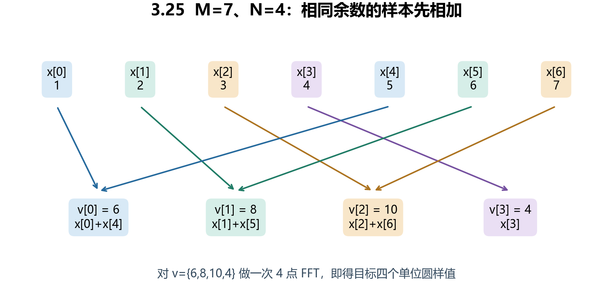

# 第三章 · DFT 与 FFT

> 指定作业：**3.1、3.8、3.11、3.14、3.25**。
> 五道题分别练：DFS 周期长度变换、周期输入的 LTI 响应、DFT 圆周对称、插零的 DFT、用 FFT 计算指定单位圆采样。

## 本章题型路线

| 题面给什么 | 先写什么 | 对应题号 |
|---|---|---|
| 同一周期序列按更长周期做 DFS | 拆开重复的块，处理旋转因子的相长和相消 | 3.1 |
| 周期输入通过 LTI | 逆 DFS 写成复指数，逐频率乘系统响应 | 3.8 |
| 实序列的偶/奇对称 | 下标按模 $N$，把反折与共轭对称结合 | 3.11 |
| 点间插零或指定单位圆样值 | 先写新 DFT 的求和，再决定重复、折叠或尾补零 | 3.14、3.25 |

| 题型 | 课后题直达 |
|---|---|
| [周期延拓与 DFS](#practice-3-1) | [3.2](#exercise-3-2)、[3.3](#exercise-3-3)、[3.4](#exercise-3-4)、[3.5](#exercise-3-5) |
| [DFT 定义、调制与对称性](#practice-3-2) | [3.6](#exercise-3-6)、[3.7](#exercise-3-7)、[3.12](#exercise-3-12)、[3.15](#exercise-3-15)、[3.17](#exercise-3-17) |
| [频域采样、补零与截断](#practice-3-3) | [3.13](#exercise-3-13)、[3.16](#exercise-3-16)、[3.24](#exercise-3-24) |
| [FFT 的计算与频点构造](#practice-3-4) | [3.20](#exercise-3-20)、[3.21](#exercise-3-21)、[3.22](#exercise-3-22)、[3.23](#exercise-3-23)、[3.29](#exercise-3-29)、[3.30](#exercise-3-30)、[3.31](#exercise-3-31) |
| [卷积、相关与重叠保留](#practice-3-5) | [3.9](#exercise-3-9)、[3.10](#exercise-3-10)、[3.18](#exercise-3-18)、[3.19](#exercise-3-19)、[3.26](#exercise-3-26)、[3.27](#exercise-3-27)、[3.28](#exercise-3-28) |

## 周期延拓与 DFS {#practice-3-1}

### 【课后题】3.2 · 平移或反折后的周期延拓 {#exercise-3-2}

> **做题必备知识**　对求和式里 $x[\cdot]$ 的索引取模 4。

第一列按原图索引顺序 $2,3,0,1$ 取出一个周期，第二列按 $0,3,2,1$ 取。将四点图形分别向左右复制。

### 【课后题】3.3 · 三点矩形的八点 DFS {#exercise-3-3}

> **做题必备知识**　采用正变换不除以 $N$、反变换除以 $N$ 的约定。

每周期是 $1,1,1,0,0,0,0,0$。谱线为 $1+e^{-j2\pi k/8}+e^{-j4\pi k/8}$，画正负频率时按 8 点为周期，直流为 3。

### 【课后题】3.4 · 周期卷积中的常数序列 {#exercise-3-4}

> **做题必备知识**　与周期常数 1 作周期卷积，等于把另一个序列的一整周期求和。

一周期内 $x[n]$ 有四个 1，因此周期卷积 $f[n]\equiv4$。八点 DFS 只有 $F[0]=32$，也可用 $X[0]Y[0]=4\cdot8$ 复核。

### 【课后题】3.5 · 周期不同的两列相加 {#exercise-3-5}

> **做题必备知识**　用公周期 $NM$ 计算；两列各自重复后，新的谱线只落在各自整倍数频点。

在 $NM$ 点 DFS 中，第一列在 $k=M\ell$ 写 $M X[\ell]$，第二列在 $k=N\ell$ 写 $N Y[\ell]$；其余各自为零。同一频点同时命中时相加。

## 【指定作业】3.1：同一周期序列改按 2N 周期计算 DFS {#作业3.1同一周期序列改按-2n-周期计算-dfs}

> **做题必备知识**　DFS 分析式不乘 $1/N$，合成式乘 $1/N$。把新周期看成重复的两段，用指数因子决定什么下标相加或抵消。

### 1. DTFT、DFS、DFT、FFT 的区别

| 名称 | 处理什么 | 结果是什么 | 本章用途 |
|---|---|---|---|
| DTFT | 一般离散序列 | 连续频率、2π 周期的函数 | 理解频谱、系统响应 |
| DFS | 周期序列 | 一组周期重复的离散系数 | 3.1、3.8 |
| DFT | N 个样本 | N 个频率格点上的数值 | 3.11、3.14、3.25 |
| FFT | 一种快速计算方法 | 与相同点数 DFT 完全相同的结果 | 3.25 |

FFT 不另定义一种变换。3.25 的核心是**先构造正确的 N 点输入**，再做一次 N 点 FFT。

### 2. 统一约定

$$
\boxed{W_N=e^{-j2\pi/N}.}
$$

N 点 DFT 与 IDFT：

$$
X[k]=\sum_{n=0}^{N-1}x[n]W_N^{kn},\qquad
x[n]=\frac1N\sum_{k=0}^{N-1}X[k]W_N^{-kn}.
$$

本讲义的 DFS 使用相同的归一化：

$$
\widetilde X[k]=\sum_{n=0}^{N-1}\widetilde x[n]e^{-j2\pi kn/N},\qquad
\widetilde x[n]=\frac1N\sum_{k=0}^{N-1}\widetilde X[k]e^{j2\pi kn/N}.
$$

区别是 $\widetilde x[n]$ 本来就在全体整数上周期重复；有限长 $x[n]$ 只指定一段样本。第一套 `第2章-1.ppt` 第 7 页直接采用上面的 DFS 口径。

### 题目

一个周期为 N 的序列 $\widetilde x[n]$ 也以 2N 为周期。以 N 作为周期长度计算的 DFS 为 $\widetilde X_1[k]$；以 2N 作为周期长度计算的 DFS 为 $\widetilde X_2[k]$。由前者求后者。

**注意**：题目没有改变序列，也没有在原样本之间插零，只是把 DFS 的一个计算周期从 N 点选成 2N 点。

### 推导的关键：把两段 N 点拆开

按定义

$$
\widetilde X_2[k]=\sum_{n=0}^{2N-1}\widetilde x[n]e^{-j2\pi kn/(2N)}.
$$

将后半段令 $n=m+N$，利用 $\widetilde x[m+N]=\widetilde x[m]$：

$$
\begin{aligned}
\widetilde X_2[k]
&=\sum_{m=0}^{N-1}\widetilde x[m]e^{-j\pi km/N}
+\sum_{m=0}^{N-1}\widetilde x[m]e^{-j\pi k(m+N)/N}\\
&=\left(1+e^{-j\pi k}\right)
\sum_{m=0}^{N-1}\widetilde x[m]e^{-j\pi km/N}\\
&=\left(1+(-1)^k\right)
\sum_{m=0}^{N-1}\widetilde x[m]e^{-j\pi km/N}.
\end{aligned}
$$

若 $k=2r$ 为偶数，前因子为 2，指数化为原来 N 点 DFS 的指数：

$$
\widetilde X_2[2r]=2\sum_{m=0}^{N-1}\widetilde x[m]e^{-j2\pi rm/N}
=2\widetilde X_1[r].
$$

若 k 为奇数，前因子为零。

### 最终结果

在 $0\le k\le2N-1$ 内，

$$
\boxed{
\widetilde X_2[k]=\begin{cases}
2\widetilde X_1[k/2],&k\text{ 为偶数},\\
0,&k\text{ 为奇数}.
\end{cases}}
$$

之后按 2N 周期延拓。原谱线保留在新频率格点的偶数位置，新增的奇数格点没有成分。

### 为什么系数加倍却没有使原信号幅度加倍

因为逆变换的系数也从 $1/N$ 变为 $1/(2N)$：

$$
\frac1{2N}\cdot2\widetilde X_1[r]
=\frac1N\widetilde X_1[r].
$$

若有人把“傅里叶级数系数”定义成 $c_N[k]=\widetilde X_1[k]/N$，则新系数满足 $c_{2N}[2r]=c_N[r]$，而不是加倍。两种记法都可成立，但不能混用定义。

### 一眼检查与推广

选常数序列 $\widetilde x[n]\equiv1$：N 点求和的 DC 为 N，2N 点求和的 DC 为 2N，验证了因子 2。

改按 qN 周期计算时，同理得到

$$
\widetilde X_q[k]=\begin{cases}
q\widetilde X_1[k/q],&k\equiv0\pmod q,\\
0,&\text{其他}.
\end{cases}
$$

**大题记忆线**：定义 → 拆成两段 → 用时域周期性 → 提取 $1+(-1)^k$ → 分奇偶。

## 【指定作业】3.8：周期输入通过 LTI 系统后的输出 {#作业3.8周期输入通过-lti-系统后的输出}

> **做题必备知识**　对 LTI，单个输入 $e^{j\omega n}$ 的输出为 $H(e^{j\omega})e^{j\omega n}$。先展开逆 DFS，频响的自变量跟着合成式中的复指数频率走。

### 题目与必要条件

周期为 N 的 $\widetilde x[n]$ 通过系统 $H(z)$，用其 DFS 系数 $\widetilde X[k]$ 表示输出 $\widetilde y[n]$。

本题按 LTI 系统解释，并要求相关频率处的响应存在。一个足够条件是 $h[n]$ 绝对可和，即系统 BIBO 稳定；这样周期输入的卷积有意义。讨论的是周期稳态/对全时域周期输入的零状态响应，不额外叠加任意初值产生的自然响应。

### 先处理扫描题面的符号

扫描页把目标式写为

$$
\frac1N\sum_{k=0}^{N-1}H(W_N^k)\widetilde X[k]W_N^{-nk}.
$$

但对课件明确采用的 $W_N=e^{-j2\pi/N}$ 和 $H(z)=\sum_mh[m]z^{-m}$，与 $W_N^{-nk}=e^{j2\pi kn/N}$ 对应的系统增益应当是

$$
\boxed{H(e^{j2\pi k/N})=H(W_N^{-k}).}
$$

因此**扫描目标式与本课件约定存在一处符号不一致**。下文用明确的指数形式推导，不把这个符号差异悄悄忽略。作答时可先写明 W 的定义，再写推导与指数形式结果；若老师采用其他定义，应整套核对正、逆变换，不能只改单个符号。

### 方法一：复指数是 LTI 系统的特征输入

先看单个复指数 $e^{j\omega_kn}$，其中 $\omega_k=2\pi k/N$：

$$
\begin{aligned}
\sum_{m=-\infty}^{\infty}h[m]e^{j\omega_k(n-m)}
&=e^{j\omega_kn}\sum_mh[m]e^{-j\omega_km}\\
&=H(e^{j\omega_k})e^{j\omega_kn}.
\end{aligned}
$$

它通过系统后频率不变，只乘一个复数增益。再把输入用逆 DFS 展开：

$$
\widetilde x[n]=\frac1N\sum_{k=0}^{N-1}\widetilde X[k]e^{j\omega_kn}.
$$

利用线性逐项通过系统，得到

$$
\boxed{
\widetilde y[n]=\frac1N\sum_{k=0}^{N-1}
H(e^{j2\pi k/N})\widetilde X[k]e^{j2\pi kn/N}.
}
$$

等价地，在本讲义 W 约定下：

$$
\boxed{
\widetilde y[n]=\frac1N\sum_{k=0}^{N-1}
H(W_N^{-k})\widetilde X[k]W_N^{-kn}.
}
$$

### 方法二：从卷积直接代入，适合卷面证明

$$
\begin{aligned}
\widetilde y[n]
&=\sum_mh[m]\widetilde x[n-m]\\
&=\sum_mh[m]\frac1N\sum_{k=0}^{N-1}
\widetilde X[k]e^{j\omega_k(n-m)}\\
&=\frac1N\sum_{k=0}^{N-1}\widetilde X[k]e^{j\omega_kn}
\underbrace{\sum_mh[m]e^{-j\omega_km}}_{H(e^{j\omega_k})}.
\end{aligned}
$$

即得上式。这里一个和为有限和；在上述收敛条件下交换求和成立。

### 本题还应读出的两个结论

$$
\boxed{\widetilde Y[k]=H(e^{j2\pi k/N})\widetilde X[k].}
$$

1. 每根离散谱线单独乘以系统在该频率的响应。
2. 输出仍以 N 为一个周期，但**基波周期可能缩短**，例如系统滤掉部分谱线，或输出恒为零。

### 用一拍延迟检查正负号

取 $h[n]=\delta[n-1]$，则 $H(z)=z^{-1}$，输入 $e^{j\omega_kn}$ 应输出 $e^{-j\omega_k}e^{j\omega_kn}$。

- 正确代入 $H(e^{j\omega_k})=e^{-j\omega_k}$，得到延迟。
- 若误代入 $H(e^{-j\omega_k})$，则得到 $e^{j\omega_k}$，变成超前。

例如 $N=4$、$\widetilde x[n]=\sin(\pi n/2)$ 时，一拍延迟的实际输出为 $-\cos(\pi n/2)$。若按题面误代，算出的却是 $+\cos(\pi n/2)$。取 $n=0$ 就能直接看出差别。

## DFT 定义、调制与对称性 {#practice-3-2}

### 【课后题】3.6 · 冲激、指数与斜坡的 DFT {#exercise-3-6}

> **做题必备知识**　代入 $W_N=e^{-j2\pi/N}$；有限几何和的分母为零时用原和取值。

（1）为 1；（2）为 $W_N^{kn_0}$；（3）为 $(1-a^N)/(1-aW_N^k)$，分母为零时为 $N$；（4）$k=0$ 时为 $N(N-1)/2$，其余为 $-N/(1-W_N^k)$。

### 【课后题】3.7 · DFT 连续做两次 {#exercise-3-7}

> **做题必备知识**　指数核的内层和只在整数索引之和为 $N$ 的倍数时等于 $N$。

交换双和后，$\sum_k W_N^{k(n+m)}$ 筛出 $n=(-m)\bmod N$，结果为 $N x[(-m)\bmod N]$。

### 【课后题】3.12 · 余弦和正弦调制的 DFT {#exercise-3-12}

> **做题必备知识**　先把三角函数写成两个指数，频域索引按 $N$ 取模。

余弦得到 $(X[k-m]+X[k+m])/2$；正弦得到 $(X[k-m]-X[k+m])/(2j)$。两者都可用实序列的共轭对称检验结果。

### 【课后题】3.15 · 用一个复 DFT 拆出两路实序列 {#exercise-3-15}

> **做题必备知识**　对实序列，DFT 满足 $X^*[(-k)\bmod N]=X[k]$。

设 $F_r[k]=F^*[(-k)\bmod N]$，取 $X=(F+F_r)/2$、$Y=(F-F_r)/(2j)$。（1）两项有限几何和分别还原为题设的指数段 $a^n,b^n$（实参数）。（2）$X[k]=1,Y[k]=N$，时域在 $n=0$ 分别取 1、$N$，其余为零。

### 【课后题】3.17 · 交替乘号与首尾翻转 {#exercise-3-17}

> **做题必备知识**　用 DFT 定义使指数和模 $N$ 索引对齐。

（1）$N$ 为偶数时移频 $N/2$ 点；奇数时是半格移频，应直接在 DTFT 的偏移频点取样，或对 DFT 样点作圆周插值。（2）$x[N-1-n]$ 相当于圆周反折后提前一格，得 $W_N^{-k}X[(-k)\bmod N]$。

## 【指定作业】3.11：证明实圆周偶/奇序列的 DFT 对称性 {#作业3.11证明实圆周偶奇序列的-dft-对称性}

> **做题必备知识**　先区分普通反折与模 $N$ 圆周反折。实序列有共轭对称，圆周偶/奇再给一条独立关系，两条关系合起来才能判断实部、虚部。

### 模 N 下标是什么

记 $(r)_N$ 为 r 除以 N 的余数，结果取 $0,1,\ldots,N-1$。

例如 N=4 时，$(-1)_4=3$、$(-2)_4=2$。所以圆周反折

$$
x[(-n)_4]=\{x[0],x[3],x[2],x[1]\}.
$$

这与把四个数从右往左写成 $\{x[3],x[2],x[1],x[0]\}$ 不同。

### 题目

证明：若 N 点实序列满足 $x[n]=x[N-n]$，则 $X[k]$ 为实且偶对称；若满足 $x[n]=-x[N-n]$，则 $X[k]$ 为纯虚且奇对称。

这里 $N-n$ 必须按模 N 理解，即 $x[(N-n)_N]$，特别是 $n=0$ 时对应自己。

### 第一步：由实序列得到共轭对称

由于 $x[n]\in\mathbb R$，

$$
\begin{aligned}
X^*[k]
&=\sum_{n=0}^{N-1}x[n]e^{j2\pi kn/N}\\
&=X[(-k)_N].
\end{aligned}
$$

因此

$$
\boxed{X[(-k)_N]=X^*[k].}
$$

“实序列”只保证共轭对称，本身不保证频谱全实。

### 第二步：圆周反折带来频域反折

令 $v[n]=x[(-n)_N]$，对其做 DFT，并换元 $m=(-n)_N$。n 遍历一个周期时 m 也恰好遍历一个周期：

$$
\begin{aligned}
V[k]
&=\sum_{n=0}^{N-1}x[(-n)_N]e^{-j2\pi kn/N}\\
&=\sum_{m=0}^{N-1}x[m]e^{j2\pi km/N}\\
&=X[(-k)_N].
\end{aligned}
$$

### 第三步：分别合并偶、奇条件

**实圆周偶序列**满足 $v[n]=x[n]$，故

$$
X[(-k)_N]=X[k].
$$

再与共轭对称结合：

$$
X[k]=X[(-k)_N]=X^*[k].
$$

因此

$$
\boxed{X[k]\in\mathbb R,\qquad X[k]=X[(-k)_N].}
$$

**实圆周奇序列**满足 $v[n]=-x[n]$，故

$$
X[(-k)_N]=-X[k].
$$

与共轭对称结合：

$$
X^*[k]=-X[k].
$$

这表示实部为零，因此

$$
\boxed{X[k]\in j\mathbb R,\qquad X[k]=-X[(-k)_N].}
$$

这里“纯虚”允许数值为零。

### 用三角函数再理解一遍

$$
X[k]=\sum_nx[n]\cos\frac{2\pi kn}{N}
-j\sum_nx[n]\sin\frac{2\pi kn}{N}.
$$

圆周偶 x 与奇正弦相乘后，配对相消，虚部为零；圆周奇 x 与偶余弦相乘后配对相消，实部为零。这是上面代数证明的直观解释。

### 固定点不可漏

圆周奇序列在反折后仍落回自己的位置必须为零：

$$
x[0]=0;\qquad N\text{ 为偶数时， }x[N/2]=0.
$$

频域同理，奇频谱满足 $X[0]=0$，偶数 N 时 $X[N/2]=0$。

### 四点例子

$$
\{2,1,0,1\}\overset{\mathrm{DFT}_4}{\longleftrightarrow}\{4,2,0,2\},
$$

是实圆周偶到实圆周偶；

$$
\{0,1,0,-1\}\overset{\mathrm{DFT}_4}{\longleftrightarrow}\{0,-2j,0,2j\},
$$

是实圆周奇到纯虚圆周奇。

反过来，普通左右对称数组 $\{1,2,2,1\}$ 的 DFT 是 $\{6,-1-j,0,-1+j\}$，并不全实。因为它关于 $n=(N-1)/2$ 对称，不是关于圆周原点对称。

**大题记忆线**：实 → 共轭对称；圆周偶/奇 → 频域偶/奇；两条件合并 → 全实/纯虚。

## 【期末原题】第 6 题 · 实序列 DFT 的共轭对称

> **做题必备知识**　在 DFT 指数中代入 $N-k$，利用 $e^{-j2\pi n}=1$。只剩指数正负号的差异，实输入允许把它写成共轭。

将 $N-k$ 代入 DFT 定义，用 $e^{-j2\pi n}=1$ 和 $x[n]\in\mathbb R$ 得 $X[N-k]=X^*[k]$。偶数 $N$ 时 $N-N/2=N/2$，该点等于自己的共轭，故为实数。

## 频域采样、补零与截断 {#practice-3-3}

### 【课后题】3.13 · 末尾补零后频谱格点变密 {#exercise-3-13}

> **做题必备知识**　DFT 是在 DTFT 上等距取样；$r$ 倍补零使格点间隔变为原来的 $1/r$。

新谱每隔 $r$ 点等于原谱，即 $Y[r\ell]=X[\ell]$。中间频点对原有限序列按 $rN$ 点 DFT 直接求和，或用原 $X[k]$ 经 Dirichlet 核插值。

### 【课后题】3.16 · 对无限指数的 z 变换采样再 IDFT {#exercise-3-16}

> **做题必备知识**　单位圆上取 $N$ 个等距点，会把时域以 $N$ 为周期叠加。

对 $0\le n<N$，结果为 $\sum_{m=0}^{\infty}a^{n+mN}=a^n/(1-a^N)$。分母是后续相隔 $N$ 的尾部折回造成的。

### 【课后题】3.24 · 有限窗的零点与主瓣 {#exercise-3-24}

> **做题必备知识**　$u[n]$ 的 z 变换在 $z=1$ 有极点。截断后用有限几何和，注意约掉公因子。

截断后的零点是除 1 外的 $N$ 次单位根，原点有 $N-1$ 重极点。幅度为 $|\sin(N\omega/2)/\sin(\omega/2)|$；直流峰高 $N$，主瓣两侧的第一零点为 $\pm2\pi/N$。

## 【指定作业】3.14：时域插零后做 rN 点 DFT {#作业3.14时域插零后做-rn-点-dft}

> **做题必备知识**　时域在点间插零会移动样本的下标，尾部补零则保留下标。用 $n=rm$ 代入新 DFT 的指数核。

### 题目

已知 N 点有限长序列 $x[n]$ 的 N 点 DFT 为 $X[k]$。每两点之间插入 $r-1$ 个零，按 rN 点表示新序列

$$
y[n]=\begin{cases}
x[n/r],&n=rm,\ m=0,1,\ldots,N-1,\\
0,&\text{其他},
\end{cases}
$$

求其 **rN 点 DFT** 与 X 的关系。r 为正整数；最后一组后的零也计入 rN 点数组。

### 完整推导

$$
\begin{aligned}
Y[k]
&=\sum_{n=0}^{rN-1}y[n]e^{-j2\pi kn/(rN)}\\
&=\sum_{m=0}^{N-1}x[m]e^{-j2\pi k(rm)/(rN)}\\
&=\sum_{m=0}^{N-1}x[m]e^{-j2\pi km/N}.
\end{aligned}
$$

这是原 N 点 DFT 的表达式，但新 k 取 $0,1,\ldots,rN-1$。原表达式对 k 以 N 为周期，所以

$$
\boxed{Y[k]=X[(k)_N],\qquad 0\le k\le rN-1.}
$$

即把原 N 个 DFT 值**完整重复 r 遍**，无额外 r 或 1/r 系数。

### 小例子

N=3，r=2，若 $x=\{1,2,3\}$，则

$$
y=\{1,0,2,0,3,0\},
$$

其 6 点 DFT 为

$$
Y=\{X[0],X[1],X[2],X[0],X[1],X[2]\}.
$$

### 与“尾部补零”务必分开

| 操作 | 新时域样本 | rN 点 DFT 的含义 |
|---|---|---|
| 点间插零，本题 | 原样本改放到 rm | $Y[k]=X[(k)_N]$，旧 DFT 重复 r 遍 |
| 尾部补零 | 原样本仍放在 m | 对同一个原 DTFT 更密采样；仅 $Y[rk]=X[k]$ 保证对应 |

第一章 1.4（4）给出连续频率关系 $Y(e^{j\omega})=X(e^{jr\omega})$；把 $\omega$ 取为 $2\pi k/(rN)$，也立即得到本题结果。

**大题记忆线**：新 DFT 定义 → 只保留 $n=rm$ → 约去 r → 标明新 k 范围与模 N 周期。

## FFT 的计算与频点构造 {#practice-3-4}

### 【课后题】3.20 · 直接 DFT 与基二 FFT 的运算量 {#exercise-3-20}

> **做题必备知识**　按教材的通用计数，直接法用 $N^2$ 次复乘及 $N(N-1)$ 次复加；基二法每级有 $N/2$ 个蝶形。

$N=1024$ 时，直接法约 $125.809$ ms，FFT 约 $0.717$ ms。计数包含平凡旋转因子，若优化跳过这些乘法，实际耗时更短。

### 【课后题】3.21 · 16 点基二 DIT 与 DIF 的流图 {#exercise-3-21}

> **做题必备知识**　DIT 先拆偶、奇时域索引；DIF 先做前后半段的加减并将差乘旋转因子。

两种流图均四级、每级八个蝶形。原位实现时，DIT 可用四位倒序输入、自然频序输出；DIF 可用自然输入、四位倒序输出。

### 【课后题】3.22 · 16 点基四 FFT {#exercise-3-22}

> **做题必备知识**　把索引用四进制写成两位，并使用四点内核 $1,-j,-1,j$。

先做四个四点 DFT，经对应的十六点旋转因子，再做四个四点 DFT。按所选 DIT 或 DIF 约定，把四进制的两位交换以恢复自然序。

### 【课后题】3.23 · 15 点混合基 FFT {#exercise-3-23}

> **做题必备知识**　利用 $15=3\cdot5$，把一个长 DFT 分解成两个不同长度的小 DFT 及旋转因子。

取 $n=n_1+3n_2,\ k=k_2+5k_1$。先固定 $n_1$ 做三个五点 DFT，乘 $W_{15}^{n_1k_2}$，再固定 $k_2$ 做五个三点 DFT，按 $k_2+5k_1$ 回填。

### 【课后题】3.29 · 二维冲激的二维 DFT {#exercise-3-29}

> **做题必备知识**　二维 DFT 对行、列分别做一维 DFT；冲激在原点只留一个指数项。

对全部二维频率索引 $(k,\ell)$，变换值均为 1。

### 【课后题】3.30 · 一般圆周上等距取样 z 变换 {#exercise-3-30}

> **做题必备知识**　先吸收半径 $r$ 与起角 $\theta$，再按 $M$ 折叠；原序列起点 $n_0$ 会引入频点相关因子。

令 $v[m]=x[n_0+m](re^{j\theta})^{-m}$，将 $v[m]$ 按模 $M$ 相加后做 $M$ 点 DFT，最后逐点乘 $z_k^{-n_0}$。对 $M=N,r=1$，直接将序列乘相位斜坡再做 FFT。

### 【课后题】3.31 · 一次 N 点 IDFT 恢复 2N 点实序列 {#exercise-3-31}

> **做题必备知识**　先分出实序列的偶、奇索引谱，再把两路时域结果打包成一个复序列。

用 $G[k]=(X[k]+X[k+N])/2$、$H[k]=W_{2N}^{-k}(X[k]-X[k+N])/2$。对 $G+jH$ 做一次 $N$ 点 IDFT，实部是 $x[2n]$，虚部是 $x[2n+1]$。

## 【指定作业】3.25：用一次 N 点 FFT 求单位圆 N 个样值 {#作业3.25用一次-n-点-fft-求单位圆-n-个样值}

> **做题必备知识**　先把单位圆采样位置代进 $X(z)$。与 $N$ 相差整数倍的下标在所有目标点上的指数相同，可以先相加。

### 题目

x 为 M 点有限长序列，$0\le n\le M-1$，其 z 变换为

$$
X(z)=\sum_{n=0}^{M-1}x[n]z^{-n}.
$$

要求在

$$
z_k=e^{j2\pi k/N},\qquad k=0,1,\ldots,N-1
$$

处的全部样值。分别讨论 $N\le M$ 与 $N>M$，说明如何用一次 N 点 FFT 得到。

### 起点：代入单位圆采样点

$$
X(z_k)=\sum_{n=0}^{M-1}x[n]e^{-j2\pi kn/N}.
$$

这与 N 点 DFT 的指数核完全一致，问题只在于原输入有 M 点，而 FFT 需要 N 点。

### （1）N≤M：先按模 N 折叠相加

把原下标写成

$$
n=m+qN,\qquad 0\le m\le N-1.
$$

因为整数 k、q 满足

$$
e^{-j2\pi k(m+qN)/N}=e^{-j2\pi km/N},
$$

所以相隔 N 个样本对每个目标频率格点都有相同的指数因子，可以先相加。

构造 N 点序列

$$
\boxed{
v[m]=\sum_{q\ge0,\ m+qN<M}x[m+qN],\qquad m=0,\ldots,N-1.
}
$$

然后

$$
\begin{aligned}
X(z_k)
&=\sum_{m=0}^{N-1}\left(\sum_{q\ge0,\ m+qN<M}x[m+qN]\right)e^{-j2\pi km/N}\\
&=\sum_{m=0}^{N-1}v[m]e^{-j2\pi km/N}.
\end{aligned}
$$

故

$$
\boxed{X(z_k)=\operatorname{DFT}_N\{v[m]\}[k].}
$$

对 v 做一次 N 点 FFT 即得到全部指定样值。$N=M$ 时每组只有一个样本，折叠退化为直接使用原序列。

### 数值例子：M=7，N=4

取 $x=\{1,2,3,4,5,6,7\}$，按余数分组：

| 新下标 m | 合并的原样本 | v[m] |
|---|---|---|
| 0 | x[0]+x[4] | 6 |
| 1 | x[1]+x[5] | 8 |
| 2 | x[2]+x[6] | 10 |
| 3 | x[3] | 4 |

所以只需对 $v=\{6,8,10,4\}$ 做 4 点 FFT，得到

$$
\{28,-4-4j,4,-4+4j\}.
$$

这些正是原七点序列的 z 变换在四个指定单位圆点上的样值。若直接截取 $\{1,2,3,4\}$ 去做 FFT，连 DC 都会从正确的 28 变成 10。

### （2）N>M：尾部补零到 N 点

构造

$$
v[m]=\begin{cases}
x[m],&0\le m\le M-1,\\
0,&M\le m\le N-1.
\end{cases}
$$

于是

$$
\boxed{\operatorname{DFT}_N\{v\}[k]
=\sum_{m=0}^{M-1}x[m]e^{-j2\pi km/N}=X(z_k).}
$$

做一次 N 点 FFT 即可。

### 两种情况的统一表达

若把有限支撑外的 x 都视为零，则都可写为

$$
\boxed{v[m]=\sum_{q\in\mathbb Z}x[m+qN],\quad0\le m<N.}
$$

N≥M 时不会把不同的非零样本叠在一起；N<M 时同一余数类的样本可能叠加，称为时域混叠。

**这里时域混叠不妨碍求出指定频率样值**：题目要的是 N 个 $X(z_k)$，不是要求用这 N 个数唯一恢复原来的 M 个样本。恢复目标与求值目标必须分清。

### FFT 点数不能随意换

题目指定 N 个等距采样点，就需要相应的 N 点 DFT。不能为了使用基二算法，随意把 N 换成下一个 2 的幂并声称频率格点不变。N 不是 2 的幂时，数学上的 N 点 DFT 仍然成立，可使用适用点数的 FFT 方法。

**大题记忆线**：代 $z_k$ → 比较 M、N → 长则按模 N 相加，短则尾部补零 → 一次 N 点 FFT。

## 【期末原题】第 11 题 · 采样与 DFT 选点

> **做题必备知识**　采样混叠看 $f_s$，DFT 的整周期截取看 $N$。要让每条频率落在格点上，各自的 $N\omega_i/(2\pi)$ 都须是整数。

最高频率 1500 Hz，奈奎斯特速率为 3000 Hz。取 $f_s=5000$ Hz 时 $x[n]=4\sin(\pi n/4)+\cos(3\pi n/5)$，最小公共周期 40。要让两条谱线都恰落在 DFT 栅格上，最小点数 $N=40$，对应频率格点 $5$ 和 $12$（以及各自的负频率格点）。参考解在这一步的“不混叠”是按整周期采样以避免频谱泄漏理解；采样混叠由 $f_s$ 决定。

## 卷积、相关与重叠保留 {#practice-3-5}

### 【课后题】3.9 · 两个矩形段的卷积作图 {#exercise-3-9}

> **做题必备知识**　把 $y[n]$ 写成 $R_5[n]-R_5[n-5]$。

若按题面星号做线性卷积，先画 $R_5*R_5$ 的三角形，再减去它延时 5 点的版本。若按本节的 10 点循环卷积练习，将线性结果尾巴按模 10 加回。

### 【课后题】3.10 · 截断正弦、余弦的三种卷积 {#exercise-3-10}

> **做题必备知识**　线性卷积按重叠索引求和，DFT 法要补零到至少 $2N-1$。

令 $\theta=2\pi/N$，令 $k$ 从 $\max(0,n-N+1)$ 到 $\min(N-1,n)$。直接法分别对 $\cos\theta k\cos\theta(n-k)$、$\sin\theta k\sin\theta(n-k)$、$\cos\theta k\sin\theta(n-k)$ 求和，可用积化和差。频域法分别乘 $X^2,Y^2,XY$，再 IDFT。若题意取 $N$ 点循环卷积，在 $N>2$ 时三个结果分别为 $N\cos(\theta n)/2$、$-N\cos(\theta n)/2$、$N\sin(\theta n)/2$。

### 【课后题】3.18 · 循环卷积哪些点没有折回 {#exercise-3-18}

> **做题必备知识**　线性卷积最大索引为 $7+19=26$，20 点循环卷积把索引按模 20 叠加。

尾部 $20,\ldots,26$ 折到 $0,\ldots,6$，因此 $7,\ldots,19$ 保证与线性卷积一致。

### 【课后题】3.19 · 周期、循环及线性卷积比较 {#exercise-3-19}

> **做题必备知识**　同长度的周期卷积的一周期等于循环卷积。利用有效支撑可缩短 FFT。

两个向量的有效非零长度是 5、4。线性卷积为 $[1,3,6,10,14,12,9,5]$，因而 7 点循环结果为 $[6,3,6,10,14,12,9]$，做完整线性卷积最少用 8 点 DFT。

### 【课后题】3.26 · 线性相关与圆周相关 {#exercise-3-26}

> **做题必备知识**　约定 $r_{12}[\ell]=\sum_n x_1[n]x_2^*[n-\ell]$，两种相关的索引边界不同。

线性相关在 $|\ell|\le N-1$ 时，对 $n=\max(0,\ell),\ldots,\min(N-1,\ell+N-1)$ 求 $\sum a^{-n}$。圆周移位的 $x_2$ 始终全 1，故每个位移都等于 $\sum_{n=0}^{N-1}a^{-n}$。

### 【课后题】3.27 · 重叠保留法的重叠、步长与下标 {#exercise-3-27}

> **做题必备知识**　长度 $L_h=50$ 的因果滤波器需要每段开头带 $L_h-1$ 个历史样点。

采用最小重叠 49 点，100 点输入段用 128 点 FFT。每段保留 51 点，取 0 起始编号的 $49,\ldots,99$ 接到上一段后面。

### 【课后题】3.28 · 实时重叠保留的采样率上限 {#exercise-3-28}

> **做题必备知识**　每块新样点为 $1024-128+1=897$，滤波器频谱可预先计算，IDFT 可按 FFT 同样耗时估算。

单路每块耗时 $2(0.1)+1024(5\,\mu\mathrm{s})=0.20512$ s，上限约 $4373$ Hz。若两路分别计算、共用同一处理器，上限约 $2187$ Hz/路；实序列共用同一个实滤波器时，可把两路分别装入实部与虚部，按一次复卷积处理。

## 七、五题总对照：不要把“零插到哪里”记混

| 题目 | 时域操作 | 频域结果 |
|---|---|---|
| 3.1 | 同一 N 周期序列，用 2N 点表示一个周期 | 新 DFS 奇数格点为零，偶数格点为旧系数的 2 倍 |
| 3.14 | 每个原样本后插 r−1 个零 | 新 rN 点 DFT 是旧 N 点 DFT 的 r 次重复 |
| 3.25，N>M | 样本位置不变，只在尾部补零 | 同一个原 DTFT 上的 N 个频率采样 |
| 3.25，N<M | 下标同余的原样本相加 | 得到原 z 变换在 N 个指定单位圆点的值 |

## 八、本章闭卷检查

1. 3.1 中不看书推到 $1+(-1)^k$，说明为何有因子 2。
2. 3.8 写出卷积、逆 DFS 展开，指出内层求和就是频率响应，并用一拍延迟查正负号。
3. 3.11 写出“共轭对称 + 圆周偶/奇”的两条等式，再合并结论。
4. 3.14 令 $n=rm$，说明为何不是旧 DFT 末尾补零。
5. 3.25 给一个 M>N 且 M 不是 N 整倍数的例子，正确合并最后不足一组的样本。
