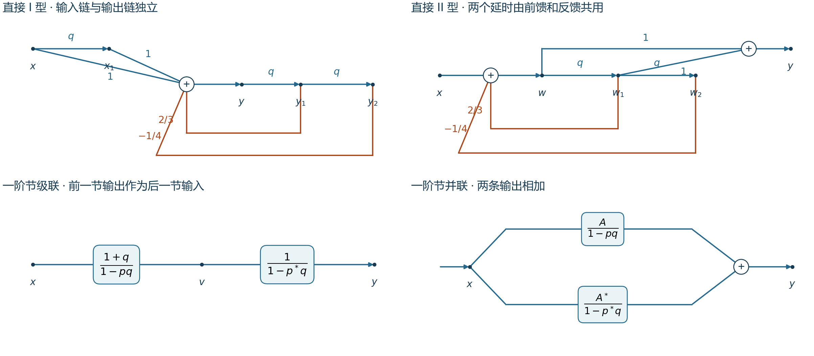

# 第六章 · 数字滤波器结构

> 指定作业 **6.1（b）、6.5、6.6**。教材习题扫描第 12–13 页（印刷页 271–272）。往年第 13、14 题可以搭配练习。

## 本章题型路线

| 类型 | 解题入口 | 对应题 |
|---|---|---|
| 读复杂流图 | 标内部节点，追每个反馈的延时数，串联乘、并联加 | 6.1（b） |
| 直接 I、II 型 | I 型拆输入链和输出链，II 型改用同一条中间变量延时链 | 6.5 |
| 级联、并联 | 级联做因式分解，并联做部分分式，共轭极点可以配对成实系数二阶节 | 6.5 |
| 横截型、转置型 | 横截型先延时再乘权重，转置型先乘再对部分和延时 | 6.6、往年 14 |

## 【作业】6.1（b）从流图求系统函数和差分方程

> **做题必备知识**　将 $z^{-1}$ 记作 $q$。每个节点等于所有入边贡献之和，先处理局部反馈，再拼级联与并联。

### 流图与差分方程怎样互译

一条支路的输出等于支路增益乘其输入。无标注的支路增益为 1。一个节点的值等于所有入边的贡献之和。记 $q=z^{-1}$，每乘一次 $q$ 就表示一拍延时。求 $Y/X$ 按零初始条件处理。从图求方程时先给反馈节点命名，再拼接级联和并联。

例如 $y[n]=x[n]+\tfrac12y[n-1]$，先写 $Y=X+\tfrac12qY$，再移项得到 $H=1/(1-\tfrac12q)$。图上回授增益 $+\tfrac12$ 对应分母中的 $-\tfrac12q$。从分母抄反馈增益时要先变回差分方程。

题图可分为左段、右侧共用的一阶反馈、最后相加的上、下支路。令 $V$ 为左段的输出，$P$ 为右侧顶端汇入 $-0.2$ 反馈后的节点，$Q$ 为右下支路中乘 4 之前的节点。以下均为 z 域关系。

### 左段逐级追两个延时

最下面的支路合成 $2X+0.5V$。先延时一拍，再与中间层的 $0.5X+1.5V$ 相加，整个中间结果再延时一拍送到顶端：

$$
V=X+q\{0.5X+1.5V+q(2X+0.5V)\},
\qquad
\frac VX=\frac{1+0.5q+2q^2}{1-1.5q-0.5q^2}.
$$

### 右段先化出公共节点 P，再将两支路相加

$$
\begin{aligned}
P&=V-0.2qP, & Y_{\text{上}}&=2P,\\
Q&=P+0.2qQ-0.8q^2Q, & Y_{\text{下}}&=(4+q+2q^2)Q.
\end{aligned}
$$

**关键节点**：$-0.2$ 的斜向箭头先汇入右侧顶端；同一节点再沿竖线向下送入下支路，所以 $Q$ 的输入项为 $P$。右下中间层朝输出的支路增益为 1，朝左反馈的增益为 0.2。

所以

$$
\begin{aligned}
\frac{Y}{V}
&=\frac{1}{1+0.2q}\left(2+\frac{4+q+2q^2}{1-0.2q+0.8q^2}\right)\\
&=\frac{6+0.6q+3.6q^2}{1+0.76q^2+0.16q^3}.
\end{aligned}
$$

### 两段级联，通分读出系数

$$
\boxed{
H(z)=\frac{6+3.6q+15.9q^2+3q^3+7.2q^4}
{1-1.5q+0.26q^2-0.98q^3-0.62q^4-0.08q^5}
}.
$$

总差分方程为

$$
\begin{aligned}
y[n]={}&6x[n]+3.6x[n-1]+15.9x[n-2]+3x[n-3]\\
&+7.2x[n-4]+1.5y[n-1]-0.26y[n-2]\\
&+0.98y[n-3]+0.62y[n-4]+0.08y[n-5].
\end{aligned}
$$

零状态冲激首项为 6。按节点递推，下一拍 $V[1]=2$、$P[1]=1.8$、$Q[1]=2$，于是 $y[1]=2(1.8)+4(2)+1=12.6$。整体差分式也给 $y[1]=3.6+1.5(6)=12.6$。左段包含约 1.7808 的极点且总分子未消去它，因此图示因果网络不稳定。

## 【期末原题】第 13 题 · 由差分方程求系统

> **做题必备知识**　先把输出项移到左边，用 $q=z^{-1}$ 写 $Y/X$。因果系统的 ROC 在最外极点之外，再看是否包含单位圆。

先移项得到 $H(z)$，再拆成一阶分式：

$$
H(z)=\frac{0.1q}{(1-0.3q)(1-0.2q)}
=\frac1{1-0.3q}-\frac1{1-0.2q}.
$$

因果 ROC 为 $|z|>0.3$，因此 $h[n]=(0.3^n-0.2^n)u[n]$。ROC 包含单位圆，系统稳定。

## 【作业】6.5 一条二阶方程的四种实现

> **做题必备知识**　先把方程写成同一个系统函数。直接 I 型分输入输出延时链，II 型共用中间变量延时链，级联分解因子，并联拆部分分式。

**延时数和阶数**：分母次数为 $N$、分子次数为 $M$ 时，未约分的直接 I 型分别用 $N$、$M$ 个延时，直接 II 型可共用 $\max(M,N)$ 个延时。存在反馈还需检查极点，因果系统须所有真极点位于单位圆内才稳定。

已知

$$
y[n]=x[n]+x[n-1]+\frac23y[n-1]-\frac14y[n-2],\qquad
H(z)=\frac{1+q}{1-\frac23q+\frac14q^2}.
$$

### （1）直接 I 型

用两条延时链。输入链的抽头 $x[n]$、$x[n-1]$ 各乘 1；输出反馈链的抽头 $y[n-1]$、$y[n-2]$ 分别乘 $2/3$、$-1/4$。四路加到输出求和点，共用 3 个延时。

### （2）直接 II 型

先做全极点部分，再做全零点部分，两者共用内部延时链：

$$
\begin{aligned}
w[n]&=x[n]+\tfrac23 w[n-1]-\tfrac14 w[n-2],\\
y[n]&=w[n]+w[n-1].
\end{aligned}
$$

从内部链取 $w[n-1]$、$w[n-2]$ 反馈到 $w$ 的求和点。另取 $w[n]$、$w[n-1]$ 求和作为输出，共用 2 个延时。

### （3）全部一阶节级联

记 $p=(2+j\sqrt5)/6$，两个极点为 $p,p^*$，$|p|=1/2$。因式分解得到

$$
H(z)=\underbrace{\frac{1+q}{1-pq}}_{\text{第一节}}
\underbrace{\frac1{1-p^*q}}_{\text{第二节}}.
$$

可画为 $x\longrightarrow H_1\longrightarrow H_2\longrightarrow y$。展开成节点方程就是 $v[n]=x[n]+x[n-1]+p\,v[n-1]$，$y[n]=v[n]+p^*y[n-1]$。也可在第一节内部令 $w[n]=x[n]+p w[n-1]$，用 $v[n]=w[n]+w[n-1]$ 让该节只用一拍延时。

### （4）全部一阶节并联

设 $H=A/(1-pq)+A^*/(1-p^*q)$。令 $q=1/p$ 求留数，有

$$
A=\frac{1+p}{p-p^*}=\frac12-j\frac4{\sqrt5}.
$$

两条一阶支路同时接收输入，再把输出相加：

$$
\begin{aligned}
v[n]&=A x[n]+p v[n-1],\\
w[n]&=A^* x[n]+p^* w[n-1],\\
y[n]&=v[n]+w[n].
\end{aligned}
$$

对实输入，零初态下 $w[n]=v^*[n]$，所以也可用一条复支路取 $2\Re v[n]$。通分检查 $A+A^*=1$、$-(Ap^*+A^*p)=1$。共轭复极点不能分成两个**实系数**一阶节。若实现限制系数全为实数，就将共轭节合成二阶实系数节。

## 【作业】6.6 七点指数 FIR 和两次乘法实现

> **做题必备知识**　从抽头表达式可直接画横截型和转置型。若系数是等比序列，先把有限几何和写成 $(1-(aq)^N)/(1-aq)$，再读两条非单位增益支路。

已知 $h[n]=0.3^n R_7[n]$，其中 $R_7[n]$ 只在 $n=0,\ldots,6$ 为 1。令 $a=0.3$。

### （1）横截型和转置型

横截型从 $x[n]$ 连续延时 6 次得到 7 个抽头，依次乘 $1,a,a^2,\ldots,a^6$ 再相加：

$$
y[n]=x[n]+0.3x[n-1]+0.09x[n-2]+\cdots+0.000729x[n-6].
$$

将流图中的支路反向，交换输入和输出的角色，求和点和分支点也随之交换。实际画法是把 $x[n]$ 扇出给各乘法器。由内向外，每级将本级乘积加上内级延时后送来的部分和：

$$
\begin{aligned}
t_6[n]&=a^6x[n],\\
t_k[n]&=a^kx[n]+t_{k+1}[n-1],\quad k=5,4,\ldots,0,\\
y[n]&=t_0[n].
\end{aligned}
$$

### （2）两次乘法来自有限几何和

$$
H(z)=\sum_{k=0}^{6}(aq)^k=\frac{1-a^7q^7}{1-aq}.
$$

乘开得到

$$
\boxed{y[n]=x[n]-0.0002187x[n-7]+0.3y[n-1]}.
$$

输入经一条单位增益直达支路和一条 7 拍延时、增益 $-a^7$ 的支路。输出另经 1 拍延时、增益 $a$ 反馈到同一个求和点。两处非单位增益只需两次乘法。验算冲激第 7 项：$a h[6]-a^7=0$，往后也都是零。虽然画出来有反馈，精确系数下冲激响应仍是有限长；量化可能破坏零极点的精确抵消。

## 【期末原题】第 14 题 · FIR 直接型与线性相位型

> **做题必备知识**　直接型由 $q^k$ 确定第 $k$ 个抽头。展开线性相位型时，先把关于中心对称、系数相同的抽头配对。

由 $H(z)=1+0.1q+0.2q^2+0.1q^3+q^4$ 画四级输入延时和五个抽头。取首尾及次首尾成对相加，可折叠为

$$
y[n]=(x[n]+x[n-4])+0.1(x[n-1]+x[n-3])+0.2x[n-2].
$$

## 五、往年题的迁移和闭卷检查

往年第 13 题直接由差分方程写 $H$、ROC、$h$ 和稳定判据，可用 6.5 的第一步。第 14 题的抽头为 $\{1,0.1,0.2,0.1,1\}$，直接型与 6.6 相同，线性相位型则可先求 $x[n]+x[n-4]$、$x[n-1]+x[n-3]$，共享相同系数。

**闭卷自测**：从 6.1（b）的右下支路单独写出分子和分母，再从 6.5 的差分方程画出两种直接型。最后给 6.6 输入一个冲激，算第 0、1、6、7 项，检查两次乘法图的反馈符号和第 7 项抵消。
